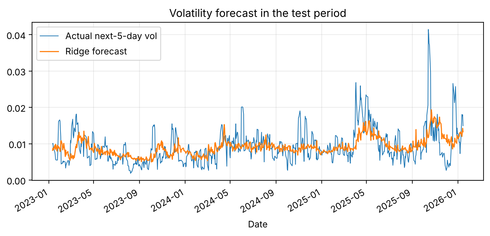

# Gold price prediction: what can and cannot be predicted

I asked a simple question: can I predict tomorrow's gold price from 10 years of daily data, and how would I know if my model is any good?

## Findings

| Question | Result |
|---|---|
| Predict the price **level** | R² = 0.999 with *no model* ("tomorrow = today"). This is a trap, so I do not use it. |
| Predict tomorrow's **return** | Ridge and gradient boosting did **not** beat the naive baseline (RMSE 0.0105 vs 0.0105 and 0.0107; direction right 49% and 55% vs 56% for always guessing "up"). |
| Trade on that prediction (long/flat, no costs) | Holding won at the end (cumulative log return 0.95 vs 0.59 and 0.89). |
| Predict next-5-day **volatility** | Yes: ridge cuts the error about 12% and boosting about 17% versus "same as the last 20-day volatility". |

Takeaway: a high R² on price levels is not skill. Returns are close to unpredictable from past prices; volatility is predictable and useful for risk.



## Method
- Data: `data/gold_prices_10y.csv`, 2,511 daily rows, 2016-01-29 to 2026-01-23 (prices look like a gold ETF; check the source before reusing).
- Features use only information from before the predicted day: lagged returns, moving-average gaps, volatility, daily range, volume change.
- **Walk-forward test:** 12 refits on an expanding window, tested on the last 3 years (756 days). No shuffling, no leakage.
- Models: ridge and gradient boosting (scikit-learn), compared with naive baselines.

## Limits
One asset, one period (a long gold rally), no transaction costs, features from prices only, data ends January 2026. Next steps: macro variables (dollar index, real yields), costs in the trading test, GARCH-type volatility models.

## Run it
```
pip install -r requirements.txt
jupyter notebook Gold_Price_Prediction.ipynb
```
